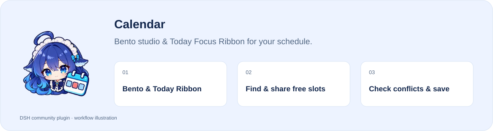

[简体中文](README.md) · **English**

# Calendar

**DeepSeek Harness native calendar workbench: opens in tactile Bento studio layout with a live Today Focus Ribbon (today badge, next-event countdown, conflict-free pill, 1-click `+ Quick event`), CalDAV scheduling, open-slot finder, ICS preview import, 4 layouts, 13 styles, and 8 fonts.**

[](https://www.npmjs.com/package/dsh-calendar) [](https://www.npmjs.com/package/dsh-calendar) [](https://www.npmjs.com/package/dsh-calendar)

**[Install](#install) · [Workflow](#start-using-it) · [Full guide](https://github.com/STARDUSTLC666/dsh-calendar/blob/main/docs/REFERENCE.en.md)**

<picture>
  <source media="(prefers-color-scheme: dark) and (max-width: 640px)" srcset="https://raw.githubusercontent.com/STARDUSTLC666/dsh-calendar/main/docs/assets/intro/workflow-en-mobile-dark.svg">
  <source media="(max-width: 640px)" srcset="https://raw.githubusercontent.com/STARDUSTLC666/dsh-calendar/main/docs/assets/intro/workflow-en-mobile-light.svg">
  <source media="(prefers-color-scheme: dark)" srcset="https://raw.githubusercontent.com/STARDUSTLC666/dsh-calendar/main/docs/assets/intro/workflow-en-dark.svg">
  
</picture>

## Features

- **Bento studio default + Today Focus Ribbon**: Opens straight into the tactile **Bento** card grid (switchable between Native / Floating / Spotlight / Bento in one click), paired with a compact **Today Focus Ribbon** showing today's date badge, next-event countdown, conflict status, and a 1-click **`+ Quick event`** pill.
- **Month, week & agenda scheduling**: Drag-to-reschedule in week view (15-min snap + 5-second undo), iCloud calendar auto-discovery, and reviewed smart event drafts from pasted text or screenshots.
- **Find & share open slots**: Search candidates by duration, weekdays, and buffers, then click **Copy free slots summary** to paste formatted meeting options straight into WeChat, DingTalk, Slack, or email.
- **Interactive `? Tour` spotlight guide**: 4-step topbar coachmark tour (Today Focus Ribbon -> Bento layout & views -> Find available time + 1-click prompt copy -> Conflict checks & smart drafts).
- **Review before writing + 13 styles & 8 fonts**: Every draft and ICS import checks overlaps and duplicates before saving; switch across 13 visual styles, 4 event palettes, and 8 curated fonts (`Rounded Mono` default) with calm slate dark mode.

<details>
<summary>See a workbench example</summary>


Calendar running in DeepSeek Harness 0.2.2-rc.3 (default Bento layout + Today Focus Ribbon) with sample events.

</details>

## Install

Open **Plugins** in the DSH desktop app and install `dsh-calendar`. If the CLI is available:

```bash
dsh plugin --profile desktop add dsh-calendar
```

For the web profile, replace `desktop` with `web`. Restart that DSH profile after installation. The package’s DSH requirement is `>=0.2.2-rc.3`.

## Start using it

### Three-step workflow: Open Bento & Today Ribbon -> Find & share free slots -> Check conflicts & save

1. **Open the Bento studio & Today Focus Ribbon**: Open **Calendar** in the sidebar to see the default **Bento** card layout and live **Today Focus Ribbon** (today badge, next event countdown, conflict indicator, and `+ Quick event`). Choose iCloud, Google, Nextcloud, or custom CalDAV in **Connection**, run **Test connection**, and save—or click **See a sample** first.
2. **Switch views & share free slots**: Press `M / W / A` for month/week/agenda or switch `Native / Floating / Spotlight / Bento` in the header. Press `F` for **Find available time**, set duration, working hours, and buffers, then click **Copy free slots summary** to share options—or **Create with this time** to open a pre-filled draft.
3. **Verify conflicts & review with your assistant**: Click **`+ Quick event`** on the Today Focus Ribbon (or **New event**) to extract drafts from messages/screenshots with overlap alerts, preview `.ics` files before importing, or open **? Tour** in the topbar to copy ready-made DSH chat prompts:

- `Find two 45-minute free slots this week in the afternoon (13:30–18:00) with a 15-minute buffer, and list the candidates first without creating an event.`
- `Summarize today's meeting agenda in chronological order with locations, and highlight any scheduling overlaps.`
- `Read my schedule for next week, identify the busiest day, and list 2-hour uninterrupted blocks for deep work.`

## Before you start

Bring your own CalDAV account. Availability covers only the currently connected calendar.

Configuration, detailed tools and troubleshooting: [full reference](https://github.com/STARDUSTLC666/dsh-calendar/blob/main/docs/REFERENCE.en.md).

## Plugin updates

Check updates at the bottom of the workbench or native plugin details. Automatic checks are on by default; **automatic installation is off**. You choose whether to install and when to restart. Suite-managed components update with their bundle. [Update behavior](https://github.com/STARDUSTLC666/dsh-calendar/blob/main/docs/REFERENCE.en.md).

## Documentation

- [Full usage, configuration and limits](https://github.com/STARDUSTLC666/dsh-calendar/blob/main/docs/REFERENCE.en.md)
- [Release notes](https://github.com/STARDUSTLC666/dsh-calendar/blob/main/CHANGELOG.md)
- [Validation scope and history](https://github.com/STARDUSTLC666/dsh-calendar/blob/main/docs/VALIDATION.md)

## Feedback and contributions

If the plugin helps, a Star makes it easier for others to discover. Report problems or suggest improvements in [Issues](https://github.com/STARDUSTLC666/dsh-calendar/issues); code and documentation [PRs](https://github.com/STARDUSTLC666/dsh-calendar/pulls) are welcome. Include versions and reproduction steps, and remove credentials from reports.

## License

[MIT](https://github.com/STARDUSTLC666/dsh-calendar/blob/main/LICENSE)

<a id="what-it-does"></a>
<a id="requirements-and-configuration"></a>
