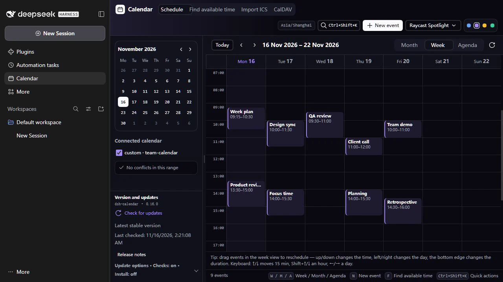

[简体中文](README.md) · **English**

# Calendar

**DeepSeek Harness native calendar workbench: manage CalDAV schedules, find open slots, preview ICS imports, and switch layouts, palettes, and five UI themes.**

[](https://www.npmjs.com/package/dsh-calendar) [](https://www.npmjs.com/package/dsh-calendar) [](https://www.npmjs.com/package/dsh-calendar)

**[Install](#install) · [Workflow](#start-using-it) · [Full guide](https://github.com/STARDUSTLC666/dsh-calendar/blob/main/docs/REFERENCE.en.md)**

<picture>
  <source media="(prefers-color-scheme: dark) and (max-width: 640px)" srcset="https://raw.githubusercontent.com/STARDUSTLC666/dsh-calendar/main/docs/assets/intro/workflow-en-mobile-dark.svg">
  <source media="(max-width: 640px)" srcset="https://raw.githubusercontent.com/STARDUSTLC666/dsh-calendar/main/docs/assets/intro/workflow-en-mobile-light.svg">
  <source media="(prefers-color-scheme: dark)" srcset="https://raw.githubusercontent.com/STARDUSTLC666/dsh-calendar/main/docs/assets/intro/workflow-en-dark.svg">
  
</picture>

## Features

- Plan with month, week and agenda views, week drag-to-reschedule, iCloud calendar discovery, and reviewed smart event drafts from text or screenshots.
- Find candidates using duration, weekdays and buffers, and click **Copy free slots summary** to paste formatted meeting options straight into WeChat, DingTalk, Slack, or email.
- Expand the compact workflow bar at the top of the workbench to copy 1-click DSH chat prompts.
- Review event drafts or ICS imports before confirming writes.
- Harmonized layouts, event palettes, and five switchable UI themes (Native Airy, Warm Cream, Claude Warmth, Bright 8-Bit, and Airy Mint) with breathable slate dark mode.

<details>
<summary>See a workbench example</summary>



Calendar 0.18.1 running in DeepSeek Harness 0.2.2-rc.3 (Mint theme) with sample events.

</details>

## Install

Open **Plugins** in the DSH desktop app and install `dsh-calendar`. If the CLI is available:

```bash
dsh plugin --profile desktop add dsh-calendar
```

For the web profile, replace `desktop` with `web`. Restart that DSH profile after installation. The package’s DSH requirement is `>=0.2.2-rc.3`.

## Start using it

### Three-step workflow: Connect calendar -> Share free slots -> Review with assistant

1. **Connect your calendar**: Open **Calendar** in the sidebar, choose iCloud, Google, Nextcloud, or custom CalDAV in **Connection**, run **Test connection**, and save (or click **See a sample** first).
2. **Find & share free slots**: Open **Find available time** (shortcut `F`), set duration, working hours, and buffers, then click **Copy free slots summary** to paste clean time options into WeChat, DingTalk, Slack, or email—or click **Create with this time** to open a pre-filled draft.
3. **Review with your assistant**: Extract drafts from messages or screenshots in **New event**, preview `.ics` files before importing, or expand the top workflow guide to copy ready-made DSH chat prompts:

- `Find two 45-minute free slots this week in the afternoon (13:30–18:00) with a 15-minute buffer, and list the candidates first without creating an event.`
- `Summarize today's meeting agenda in chronological order with locations, and highlight any scheduling overlaps.`
- `Read my schedule for next week, identify the busiest day, and list 2-hour uninterrupted blocks for deep work.`

## Before you start

Bring your own CalDAV account. Availability covers only the currently connected calendar.

Configuration, detailed tools and troubleshooting: [full reference](https://github.com/STARDUSTLC666/dsh-calendar/blob/main/docs/REFERENCE.en.md).

## Plugin updates

Check updates at the bottom of the workbench or native plugin details. Automatic checks are on by default; **automatic installation is off**. You choose whether to install and when to restart. Suite-managed components update with their bundle. [Update behavior](https://github.com/STARDUSTLC666/dsh-calendar/blob/main/docs/REFERENCE.en.md).

## Documentation

- [Full usage, configuration and limits](https://github.com/STARDUSTLC666/dsh-calendar/blob/main/docs/REFERENCE.en.md)
- [Release notes](https://github.com/STARDUSTLC666/dsh-calendar/blob/main/CHANGELOG.md)
- [Validation scope and history](https://github.com/STARDUSTLC666/dsh-calendar/blob/main/docs/VALIDATION.md)

## Feedback and contributions

If the plugin helps, a Star makes it easier for others to discover. Report problems or suggest improvements in [Issues](https://github.com/STARDUSTLC666/dsh-calendar/issues); code and documentation [PRs](https://github.com/STARDUSTLC666/dsh-calendar/pulls) are welcome. Include versions and reproduction steps, and remove credentials from reports.

## License

[MIT](https://github.com/STARDUSTLC666/dsh-calendar/blob/main/LICENSE)

<a id="what-it-does"></a>
<a id="requirements-and-configuration"></a>
