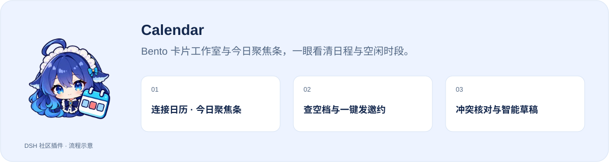

**简体中文** · [English](README.en.md)

# Calendar

**DeepSeek Harness 原生日历工作台：默认采用 Bento 卡片式工作室布局与「今日聚焦条」（今日徽章、下一日程倒计时、无冲突状态、一键 `+ 快速新建`），管理 CalDAV 日程、查找空闲时段、预览导入 ICS，支持 4 套布局与 13 套主题 + 8 种字体切换。**

[](https://www.npmjs.com/package/dsh-calendar) [](https://www.npmjs.com/package/dsh-calendar) [](https://www.npmjs.com/package/dsh-calendar)

**[安装使用](#安装) · [使用流程](#开始使用) · [完整说明](https://github.com/STARDUSTLC666/dsh-calendar/blob/main/docs/REFERENCE.zh.md)**

<picture>
  <source media="(prefers-color-scheme: dark) and (max-width: 640px)" srcset="https://raw.githubusercontent.com/STARDUSTLC666/dsh-calendar/main/docs/assets/intro/workflow-zh-mobile-dark.svg">
  <source media="(max-width: 640px)" srcset="https://raw.githubusercontent.com/STARDUSTLC666/dsh-calendar/main/docs/assets/intro/workflow-zh-mobile-light.svg">
  <source media="(prefers-color-scheme: dark)" srcset="https://raw.githubusercontent.com/STARDUSTLC666/dsh-calendar/main/docs/assets/intro/workflow-zh-dark.svg">
  
</picture>

## 功能

- **默认 Bento 卡片工作室 + 今日聚焦条**：首次打开即呈现立体卡片式 Bento 布局（可一键切换原生 / 浮岛 / 聚光 / Bento）；画布顶部的**今日聚焦条**实时汇总今日日期徽章、下一场日程倒计时、冲突状态与**「+ 快速新建」**快捷胶囊。
- **月 / 周 / 议程视图与高效排期**：支持周视图拖拽改期（15 分钟吸附 + 5 秒撤销）、iCloud 日历自动发现及从文字/截图智能生成日程草稿。
- **找空闲时段与一键邀约**：按时长、工作日与缓冲查找空闲候选，并支持**「复制空闲时段文案」**一键发到微信、钉钉、Slack 或邮件。
- **交互式「? 引导」导览**：顶栏内置 4 步聚光灯导览（聚焦今日条 -> Bento 布局与视图 -> 找空闲时段与一键复制对话指令 -> 冲突检测与智能草稿）。
- **先核对再写入 + 13 套主题与 8 种字体**：新建草稿与 ICS 导入预览均先检查冲突与去重，再确认写入；顶栏支持 13 套设计风格、4 套事件配色与 8 套字体搭配（默认幼圆等宽），深色模式柔和护眼。

<details>
<summary>查看实际示例</summary>


截图来自 DeepSeek Harness 0.2.2-rc.3 中的 Calendar（默认 Bento 布局 + 今日聚焦条），使用示例日程。

</details>

## 安装

在 DSH 桌面版「插件」面板安装 `dsh-calendar`。已配置命令行时也可使用：

```bash
dsh plugin --profile desktop add dsh-calendar
```

网页版把 `desktop` 改为 `web`；安装后重启对应的 DSH。宿主要求以包声明 `>=0.2.2-rc.3` 为准。

## 开始使用

### 三步用起来：打开 Bento 与今日聚焦条 -> 查空档发邀约 -> 冲突核对与助手协作

1. **打开 Bento 工作台与今日聚焦条**：打开左侧栏「日历」，默认进入 **Bento** 卡片布局与顶部的**今日聚焦条**（一眼掌握今日徽章、下一场日程倒计时、冲突状态与 `+ 快速新建`）；在「连接」中选择服务商（iCloud / Google / Nextcloud / 自建 CalDAV），先点「测试连接」再保存启用，首次体验也可先点「查看示例」。
2. **视图切换与查空档发邀约**：按 `M / W / A` 切换月/周/议程视图或从顶栏一键切换 `原生 / 浮岛 / 聚光 / Bento`；按 `F` 进入「找空闲时段」，设定时长、工作日与前后缓冲，查出候选后点**「复制空闲时段文案」**直接发到微信、钉钉、Slack 或邮件，或点「用此时段新建」进入草稿。
3. **冲突核对、智能草稿与助手协作**：点今日聚焦条的 `+ 快速新建` 或右上角「新建日程」，支持粘贴文字/截图生成草稿并自动提示重叠冲突，也支持 `.ics` 预览去重导入；随时点顶栏**「? 引导」**重温 4 步导览并一键复制给 DSH 对话助手的指令：

可以直接复制给 DSH 对话助手的常用指令：

- `帮我找本周下午两个 45 分钟空闲时段，工作时间按 13:30–18:00，前后预留 15 分钟缓冲，先列出候选不要直接创建。`
- `汇总今天的会议议程并提醒冲突，按时间顺序列出每场日程的起止时间与地点。`
- `读取我下周的日历安排，指出会议最密集的一天，并标出可用于深度工作的两小时整块空闲。`

## 开始前要知道

需要自己的 CalDAV 账号。空闲查询只覆盖当前连接的日历。

配置、完整工具与排错见[详细使用说明](https://github.com/STARDUSTLC666/dsh-calendar/blob/main/docs/REFERENCE.zh.md)。

## 插件更新

在工作台或原生插件详情页底部检查更新。默认自动检查，**默认不自动安装**；是否安装、何时重启由你决定。Suite 管理的组件随整包更新。[查看更新规则](https://github.com/STARDUSTLC666/dsh-calendar/blob/main/docs/REFERENCE.zh.md)。

## 文档

- [详细使用、配置与边界](https://github.com/STARDUSTLC666/dsh-calendar/blob/main/docs/REFERENCE.zh.md)
- [更新记录](https://github.com/STARDUSTLC666/dsh-calendar/blob/main/CHANGELOG.md)
- [验证范围与历史](https://github.com/STARDUSTLC666/dsh-calendar/blob/main/docs/VALIDATION.md)

## 反馈与贡献

如果插件帮到了你，欢迎 Star，让更多人发现它。问题和建议请提交 [Issues](https://github.com/STARDUSTLC666/dsh-calendar/issues)，也欢迎代码与文档 [PR](https://github.com/STARDUSTLC666/dsh-calendar/pulls)。反馈时附上版本与复现步骤，并移除凭据。

## License

[MIT](https://github.com/STARDUSTLC666/dsh-calendar/blob/main/LICENSE)

<a id="依赖与配置"></a>
