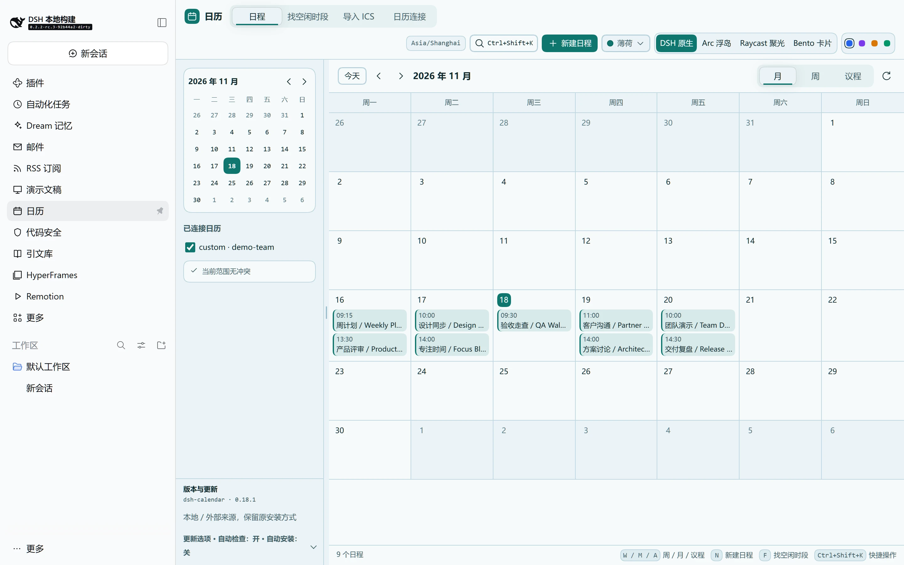

**简体中文** · [English](README.en.md)

# Calendar

**DeepSeek Harness 原生日历工作台：管理 CalDAV 日程、查找空闲时段、预览导入 ICS，支持多套布局与五种界面主题切换。**

[](https://www.npmjs.com/package/dsh-calendar) [](https://www.npmjs.com/package/dsh-calendar) [](https://www.npmjs.com/package/dsh-calendar)

**[安装使用](#安装) · [使用流程](#开始使用) · [完整说明](https://github.com/STARDUSTLC666/dsh-calendar/blob/main/docs/REFERENCE.zh.md)**

<picture>
  <source media="(prefers-color-scheme: dark) and (max-width: 640px)" srcset="https://raw.githubusercontent.com/STARDUSTLC666/dsh-calendar/main/docs/assets/intro/workflow-zh-mobile-dark.svg">
  <source media="(max-width: 640px)" srcset="https://raw.githubusercontent.com/STARDUSTLC666/dsh-calendar/main/docs/assets/intro/workflow-zh-mobile-light.svg">
  <source media="(prefers-color-scheme: dark)" srcset="https://raw.githubusercontent.com/STARDUSTLC666/dsh-calendar/main/docs/assets/intro/workflow-zh-dark.svg">
  
</picture>

## 功能

- 用月、周或议程视图安排日程，支持周视图拖拽改期、iCloud 日历自动发现及从文字/截图智能草稿填写。
- 按时长、工作日与缓冲查找空闲候选，并支持**「复制空闲时段文案」**一键发到微信、钉钉、Slack 或邮件。
- 工作台顶部内置可折叠流程指南与一键复制的对话巡检指令气泡。
- 先核对新建草稿或 ICS 导入预览，再确认写入。
- 内置多套布局、事件配色与五种界面主题切换（原生清透 / 米白纸感 / Claude 暖书卷 / 8-Bit 像素 / 晴空薄荷），深色模式采用柔和石板灰。

<details>
<summary>查看实际示例</summary>



截图来自 DeepSeek Harness 0.2.2-rc.3 中的 Calendar 0.18.1（薄荷主题），使用示例日程。

</details>

## 安装

在 DSH 桌面版「插件」面板安装 `dsh-calendar`。已配置命令行时也可使用：

```bash
dsh plugin --profile desktop add dsh-calendar
```

网页版把 `desktop` 改为 `web`；安装后重启对应的 DSH。宿主要求以包声明 `>=0.2.2-rc.3` 为准。

## 开始使用

### 三步用起来：连接日历 -> 查空档发邀约 -> 让助手巡检日程

1. **连接日历**：打开左侧栏「日历」，在「日历连接」选择服务商（iCloud / Google / Nextcloud / 自建 CalDAV），先点「测试连接」验证读取，再保存启用；首次上手也可先点「查看示例」。
2. **查空档发邀约**：切到「找空闲时段」（快捷键 `F`），设定时长、工作时间与前后缓冲；查出候选后既可点**「复制空闲时段文案」**直接粘贴到微信、钉钉、Slack 或邮件跟对方约时间，也可点「用此时段新建」进入草稿核对保存。
3. **让助手巡检日程**：新建日程时支持从通知文字或截图生成草稿；也可展开工作台顶部的流程条一键复制对话指令发给 DSH 助手，或导入 `.ics` 文件预览去重后写入。

可以直接复制给 DSH 对话助手的常用指令：

- `帮我找本周下午两个 45 分钟空闲时段，工作时间按 13:30–18:00，前后预留 15 分钟缓冲，先列出候选不要直接创建。`
- `汇总今天的会议议程并提醒冲突，按时间顺序列出每场日程的起止时间与地点。`
- `读取我下周的日历安排，指出会议最密集的一天，并标出可用于深度工作的两小时整块空闲。`

## 开始前要知道

需要自己的 CalDAV 账号。空闲查询只覆盖当前连接的日历。

配置、完整工具与排错见[详细使用说明](https://github.com/STARDUSTLC666/dsh-calendar/blob/main/docs/REFERENCE.zh.md)。

## 插件更新

在工作台或原生插件详情页底部检查更新。默认自动检查，**默认不自动安装**；是否安装、何时重启由你决定。Suite 管理的组件随整包更新。[查看更新规则](https://github.com/STARDUSTLC666/dsh-calendar/blob/main/docs/REFERENCE.zh.md)。

## 文档

- [详细使用、配置与边界](https://github.com/STARDUSTLC666/dsh-calendar/blob/main/docs/REFERENCE.zh.md)
- [更新记录](https://github.com/STARDUSTLC666/dsh-calendar/blob/main/CHANGELOG.md)
- [验证范围与历史](https://github.com/STARDUSTLC666/dsh-calendar/blob/main/docs/VALIDATION.md)

## 反馈与贡献

如果插件帮到了你，欢迎 Star，让更多人发现它。问题和建议请提交 [Issues](https://github.com/STARDUSTLC666/dsh-calendar/issues)，也欢迎代码与文档 [PR](https://github.com/STARDUSTLC666/dsh-calendar/pulls)。反馈时附上版本与复现步骤，并移除凭据。

## License

[MIT](https://github.com/STARDUSTLC666/dsh-calendar/blob/main/LICENSE)

<a id="依赖与配置"></a>
